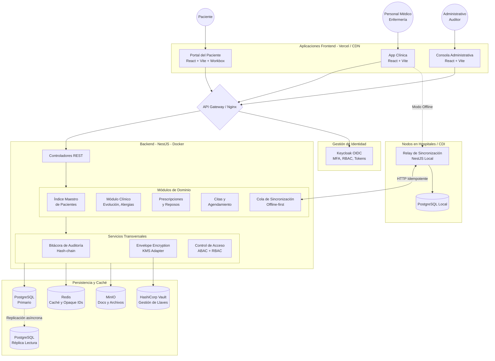

# Diagrama de Componentes SNHCE

Este documento ilustra la arquitectura de alto nivel del Sistema Nacional Interoperable de Historia Clínica Electrónica (SNHCE) para la red de salud pública de Venezuela.

## Arquitectura General (Monolito Modular)

## Flujos Críticos de Seguridad

1. **Autenticación (Keycloak):** Todos los frontends usan el flujo Authorization Code con PKCE. Los tokens son de corta duración.
2. **Cifrado en reposo:** Los datos sensibles (nombres de pacientes, evolución médica, etc.) pasan por el `CryptoService` antes de guardarse en base de datos.
3. **Auditoría inmutable:** Cualquier lectura o escritura en los módulos clínicos llama al `AuditService`, que encadena el hash con el registro anterior, garantizando que no se puedan borrar o alterar accesos.
4. **Offline-first:** Cuando la conexión del hospital cae, la *App Clínica* encola las operaciones (Outbox pattern). Si el hospital tiene un *Nodo Local*, la app se conecta al relay; si no, espera a recuperar conexión 4G/Wifi.
